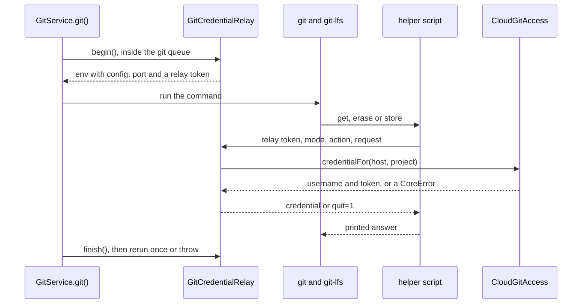

# Git credentials

Core answers git's credential requests through its own helper, a relay to Core over loopback TCP. It serves elek.io Cloud's git hosts with the session's git tokens, and every other host with `ELEK_IO_REMOTE_ACCESS_TOKEN` while that is set. The consumer side is in [`../docs/cloud-git.md`](../docs/cloud-git.md) and [`../docs/usage.md`](../docs/usage.md#environment-variables).

Read this before changing how `GitService` builds git's environment, [`GitCredentialRelay`](../src/util/gitCredentialRelay.ts), [`CloudGitAccess`](../src/util/cloudGit.ts) or the helper script in [`gitCredential.ts`](../src/util/gitCredential.ts).

## How it works

Every invocation that runs a git command gets `GIT_TERMINAL_PROMPT=0`, an empty `GIT_ASKPASS` and these entries in `GIT_CONFIG_PARAMETERS`, in this order:

| Entry | Present |
| --- | --- |
| `credential.helper` empty, then Core's helper in `token` mode | while `ELEK_IO_REMOTE_ACCESS_TOKEN` is set |
| `credential.<pattern>.helper` empty, then Core's helper in `cloud` mode | while a pattern resolves, with or without a session |
| `credential.<pattern>.useHttpPath=true` | the same, so the path names the Project |

The scoped reset comes last, so a Cloud host never sees the remote token while Core holds a session. `--version` and `--exec-path` get the first two variables only. They run no command and so never ask, and the constructor fires them unawaited, so installing the helper for them raced a test removing the data directory.

Every invocation also gets `GIT_CONFIG_GLOBAL`, pointing at a file Core writes for `core.longpaths`, see [`testing.md`](./testing.md#what-git-was-run-with). The person's own global configuration is the first include in it, so the helpers they set there are read where they always were.

## The decisions

The owner decided the design below. Each part names what it replaced.

### A helper scoped to Cloud's git hosts

`GIT_CONFIG_PARAMETERS` rather than `-c`, so git-lfs inherits it. The person's keychain is never asked about a Cloud host, so it never gets a Cloud token to `store`, and a GitHub remote keeps the person's own helpers. gh (`git/client.go`), glab and Chromium's `git-credential-luci` scope the same way, but for one exact host. Core needs a wildcard because elek.io Cloud adds git hosts over time.

| Rejected | Why |
| --- | --- |
| Askpass answering by host | It hears no failure, and every token would sit in git's environment |
| Asking Cloud after a git failure | An ungranted Project fails with `repository not found`, so the ask never happens |
| Desktop asking per Project | It knows no Project's organization, and repeats itself after every start |
| Resetting the helpers of every host, as GitHub Desktop and JetBrains do | It takes the keychain away from a GitHub remote |
| Resolving a credential into git's environment before each command | Core would need every command's remote, git-lfs's included, would hear no `erase`, and the token would reach every process under git. A hook is no argument either way, it can run `git credential fill` through the relay |

### The pattern comes from cloud.url

`https://api.<zone>` gives `https://*.git.<zone>`, through [`cloudGitUrlOf`](../src/util/node.ts). Only the zone is read, so the pattern is always https on the default port.

- `cloud.gitUrl` and `ELEK_IO_CLOUD_GIT_URL` override it with a pattern git takes as written.
- With neither and no `api.` label, Core installs no helper and warns.
- [`naming.md`](./naming.md) argues for no other name than `gitUrl`. The resolved option is the pattern in use or `null`, so a host can show what Core uses.

| Rejected | Why |
| --- | --- |
| Deriving with no override | A local elek.io Cloud would get no helper |
| elek.io Cloud answering the pattern | A request before each process's first git command, which fails offline |
| Collecting hosts from the remotes Cloud answers | After a restart Core knows none until a Project list arrives, so the first background sync fails |

### The helper is a relay

The helper is a CommonJS script git runs as `!'<execPath>' '<script>' <mode>`, single quoted so a path with a space survives. It forwards git's request to Core and prints the answer:

- The relay token it carries is 32 random bytes, valid for one invocation and the git-lfs processes under it. The Cloud token never enters git's environment.
- Inside Electron it runs `process.execPath` with `ELECTRON_RUN_AS_NODE=1`, as VS Code's askpass does. Desktop's `electron-builder.yml` at `510df4d` sets no fuses, so `RunAsNode` is on, and the consumer docs say a host has to keep it on.
- It ignores lines it does not know, since git-lfs sends `capability[]` and `wwwauth[]`. It answers `store` with nothing, and `quit=1` when it cannot reach the relay.
- The script is named after its content's hash and rewritten when missing, so a Core of another version sharing the data directory never runs a script it did not write.

If a script relay proves unreliable on Windows, a native trampoline on GitHub Desktop's model is the fallback. Desktop built desktop-trampoline for cmd's Unicode path limits, Go launching batch files whose paths hold spaces, and logging.

### Loopback TCP, not a socket file

The relay listens on `127.0.0.1` on a random port, as GitHub Desktop does with a token per invocation. It opens on the first invocation that needs it, is unreferenced so it never keeps a host alive, and closes on `dispose()`. It is half open, because the helper ends its side after sending and still reads the answer.

| Rejected | Why |
| --- | --- |
| A Unix socket and a Windows named pipe | Two transports to test where one runs everywhere, macOS caps a socket path near 104 bytes while a data directory can run deeper, and a crashed Core leaves a stale socket file |

A loopback port is reachable by any local process. The relay token closes that, since a request without the live token gets `quit=1`.

### Core answers by host and path

[`CloudGitAccess`](../src/util/cloudGit.ts) maps `projects/<id>.git` to a Project id. The first time this session meets a Project, it asks `git-token` while it holds no token for the host, and `git-access` once it does. It keeps one token per host, and a per-host queue means two calls to one host never overlap, since a second `git-token` would revoke the first one's token.

- Grants are kept per held token and dropped with it. elek.io Cloud does not say whether a new token inherits the old one's grants, so Core asks `git-access` again rather than assume.
- A `remoteUrl` on another host than the one git asked asks `git-token` for the Project, then throws `PreconditionFailed` naming the remote to set.
- `CloudClient.tokenGeneration` changes with the token, so a new session starts with no token and no grant, and an answer that arrives after the session changed is dropped.
- Nothing here may wait on the git queue, which the command that asked still holds.

### Erase, quit=1 and the rerun

On `erase` Core drops the host's token only if it is the one git reports, so a newer token survives an older command's failure. The helper then answers `quit=1` for that host for the rest of the invocation, and `GitService` runs the command once more as a new invocation, which asks again.

The helper answers `quit=1` whenever Core has no credential for a Cloud host: signed out, after an `erase`, after a failed Cloud call, and for a path that names no Project. git stops there, so no askpass hands another provider's token to Cloud's host and no `SSH_ASKPASS` dialog opens, Desktop's background fetch every three minutes included.

| Rejected | Why |
| --- | --- |
| Answering nothing without a credential | git falls through to askpass, which hands another provider's token to Cloud's host or opens an `SSH_ASKPASS` dialog |
| `quit=1` with no exception | Core could no longer reach a Cloud remote with only `ELEK_IO_REMOTE_ACCESS_TOKEN` |

The exception is a token with no session. Signed out with `ELEK_IO_REMOTE_ACCESS_TOKEN` set, a Cloud host gets that token, as a site's build in a customer's pipeline needs.

The invocation records why it answered `quit=1`, and `GitService` throws that error when the command failed, even where its caller tolerates a non-zero exit. So an outage stays `PreconditionFailed`, which `provision()` falls back on, and a rate limit stays `RateLimited`. `lfs.push` rethrows a typed error before probing the remote, because the probe runs git again and would mint another token.

A grant taken back while Core runs leaves the token live, and git answers `repository not found` with no `erase`. Core then forgets the grant it answered, so the next command asks `git-access` again, which answers `404` once the person cannot see the Project.

### The remote token moved onto the relay

Askpass never hears that its answer failed, so with a refused `ELEK_IO_REMOTE_ACCESS_TOKEN` an LFS push looped forever. The owner chose to answer the token through the relay, which hears `erase` and answers `quit=1` afterwards, without a rerun, since the same token would be refused again.

| Rejected | Why |
| --- | --- |
| Waiting for git-lfs 3.8.0 | It bounds the loop at 3 attempts, but no dugite release bundles it, and the token stays in git's environment |
| An erase-aware helper without a relay | It would keep state in marker files on disk |

It also took the token out of git's environment and fixed askpass inside Electron, which ran `process.execPath` without `ELECTRON_RUN_AS_NODE`. The older transport alternatives still stand: `http.extraheader` puts the token on argv or into `.git/config`, a token in the URL persists and leaks into logs, and pre-seeding `git credential-cache` adds a daemon and a TTL for nothing.

### No prompt and no askpass

`GIT_TERMINAL_PROMPT=0` does not stop git from running `SSH_ASKPASS` or `core.askPass`, which some Linux desktops set. An empty `GIT_ASKPASS` stops both, so every invocation gets one. The person's credential helpers still run for hosts Core does not answer.

| Rejected | Why |
| --- | --- |
| Also setting `SSH_ASKPASS_REQUIRE=never` | It would stop ssh's own passphrase dialog for an SSH remote, which authenticates through the person's SSH setup |
| Documenting the gap only | Desktop's background fetch would open a dialog for a remote without a token |

### SSH remotes

SSH remotes authenticate through the person's SSH setup, such as keys in ssh-agent, never through the helper. `classifyAuthError` tells the transports apart, including dugite's `SSHPermissionDenied` for `Permission denied (publickey)`, and names the SSH setup rather than the token for an SSH failure.

That branch is deliberately narrow. dugite maps `SSHPermissionDenied` from git's `fatal: Could not read from remote repository.`, which git also prints for an unreachable host and a missing repository, so the classification also requires a permission signal in the output.

Without that, every offline SSH remote would throw `Unauthorized`, which `provision()` treats as unrecoverable, costing SSH consumers the offline fallback.

## Measurements

Measured with the git 2.53.0 and git-lfs 3.7.1 that dugite 3.2.2 and 3.2.3 bundle. git ran `git credential fill`, and git-lfs pushed through `HTTP_PROXY` to a local Node server answering `401` with `LFS-Authenticate: Basic`. A helper in the global config stood in for a keychain.

| What | Result |
| --- | --- |
| `credential.https://*.git.example.com.helper` | matched `cell-1.git.example.com` and `cell-22.git.example.com`, not `git.example.com`, `a.b.git.example.com` or `cell-1.git.example.com:8443` |
| The keychain on a matched host | asked nothing, neither `get` nor `store` nor `erase` |
| An empty `credential.helper` in `GIT_CONFIG_COUNT` | the scoped helper still answered, git reads `GIT_CONFIG_COUNT` before `GIT_CONFIG_PARAMETERS` |
| git-lfs under the wildcard | sends `path=projects/<id>.git`, without `/info/lfs` |
| A refused token | git calls `erase` once and fails, git-lfs calls `erase` and `get` again for as long as the helper answers, about 1,600 rounds in 30 seconds |
| A silent helper | git ran `GIT_ASKPASS`, or `SSH_ASKPASS` when only that was set, and `GIT_TERMINAL_PROMPT=0` stopped neither |
| `quit=1` | git failed with `credential helper ... told us to quit`, git-lfs with `Git credentials for ... not found`, neither ran an askpass |
| A refused token through askpass | an LFS push made 3,730 requests in 20 seconds until a timeout killed it |
| An empty `GIT_ASKPASS` | git ran neither `SSH_ASKPASS` nor `core.askPass` and failed with `terminal prompts disabled` |
| A helper path holding a space | ran when single quoted in a `!` snippet |

git-lfs 3.8.0 ([git-lfs#6018](https://github.com/git-lfs/git-lfs/pull/6018)) retries at most 3 times, through `defaultMaxAuthAttempts` in `lfsapi/auth.go`. Keep the `quit=1` after the bump anyway, or each LFS request could mint 3 tokens.

## Invariants

- No credential reaches a command line, a URL, the repository config or git's environment. Only the relay token does, and it dies with its invocation.
- Every invocation that runs a command gets the config, with or without a session. Without it, a signed out Core would let the keychain answer a Cloud host.
- The relay never waits on the git queue, or the command that asked deadlocks it.
- Two Cloud calls for one host never overlap, or the second token revokes the first.
- What Core learned under one session never answers another.
- A command reruns at most once, so a refused token costs at most two.
- The helper script holds no secret.

## Testing

[`GitService.cloudGit.test.ts`](../src/service/GitService.cloudGit.test.ts) pushes and clones real Projects over HTTP against a fake git host, see [`testing.md`](./testing.md#git-over-http). [`gitCredentialRelay.test.ts`](../src/util/gitCredentialRelay.test.ts) drives the helper with dugite's own `git credential`, which needs no HTTP and runs everywhere.

CI runs both on Linux, macOS and Windows. Neither reaches a path holding spaces or non-ASCII characters, or Electron's `ELECTRON_RUN_AS_NODE`, which need checking by hand.

## See also

- [`../docs/cloud-git.md`](../docs/cloud-git.md) - the behavior a consumer sees with a Cloud session
- [`../docs/usage.md`](../docs/usage.md#environment-variables) - the environment variables a consumer sets
- [`cloud.md`](./cloud.md) - the seam the two git calls go through, and how they map refusals
- [`error-handling-internals.md`](./error-handling-internals.md) - how a failed authentication becomes a typed error
- [`peer-dependencies.md`](./peer-dependencies.md) - the dugite range the helper runs against
