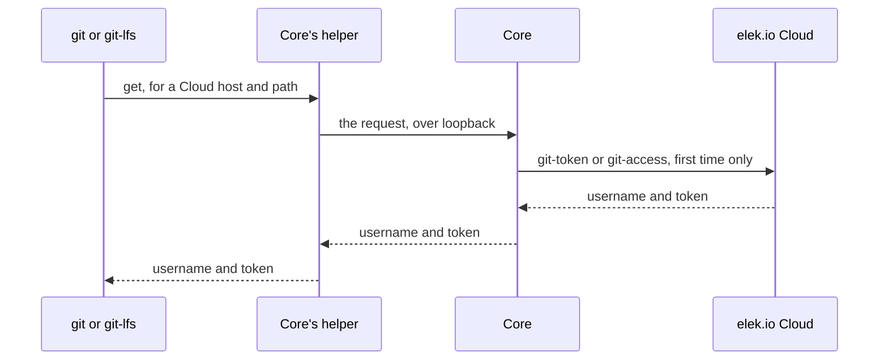

# Git with an elek.io Cloud session

Core answers git's credential requests for elek.io Cloud's git hosts itself, with tokens it asks elek.io Cloud for through the session it holds. This page covers which hosts that is, the calls Core sends, what a host application has to keep, and the errors a git operation throws. Read it before running Core against Projects stored on elek.io Cloud.

## What Core does

Every git command Core runs, a clone, a fetch, a push and every Git LFS transfer under them, asks Core's own credential helper for a Cloud host:



- The person's credential store is never asked for a Cloud host and never stores a Cloud token.
- Every other host keeps the person's own git credential helpers, or `ELEK_IO_REMOTE_ACCESS_TOKEN` while it is set.
- git never prompts and never runs an askpass program, a dialog `SSH_ASKPASS` would open included. A missing credential fails the command with a `CoreError`.

## Which hosts are Cloud's

Core derives the hosts from the `cloud.url` option. It reads only the zone after `api.`, so the scheme, port and path of the API play no part:

| `cloud.url`               | Cloud's git hosts           |
| ------------------------- | --------------------------- |
| `https://api.elek.io`     | `https://*.git.elek.io`     |
| `https://api.dev.elek.io` | `https://*.git.dev.elek.io` |
| `http://localhost:3000`   | none, Core logs a warning   |

The `*` stands for exactly one label, and a pattern without a port matches only the default port. `core.options.cloud.gitUrl` holds the pattern in use, or `null` when there is none.

Set the `cloud.gitUrl` option or `ELEK_IO_CLOUD_GIT_URL` to name the hosts yourself, such as for an elek.io Cloud running locally. git matches the value as written:

```typescript
import ElekIoCore from '@elek-io/core';

const core = new ElekIoCore({
  cloud: { url: 'http://localhost:3000', gitUrl: 'http://localhost:3300' },
});
```

A Project's remote on a Cloud host is `<host>/projects/<id>.git`, where `<id>` is the Project's id. Core reads the id from that path.

## The calls Core sends

Core asks only the first time this session meets a Project. Every path is appended to `cloud.url` and carries the session's token:

| When | Call | Answers |
| --- | --- | --- |
| The first Project on a git host | `POST /management/v1/projects/{id}/git-token` | a new token for that host |
| Every further Project on that host | `PUT /management/v1/projects/{id}/git-access` | access for the token Core holds |

- Core keeps one token per git host in memory, and never sends two of these calls for one host at once.
- When the git host refuses a token, Core drops it and runs the command once more, which asks for a new token. A second refusal throws `Unauthorized`.
- When the git host answers that a repository does not exist, Core asks `git-access` again on the next command, so access taken back elsewhere surfaces as `NotFound`.
- Signing in again, signing out and a 401 start over with no token and no access.

## One session per process

Each `git-token` replaces every token the session held on that host. Two Cores sharing one session therefore revoke each other's tokens, and their git commands fail in turns. Sign every application and command line tool in with a session of its own, and never hand a session's token to a second process or a second Core.

## Signed out

Without a session, a git command against a Cloud host throws `Unauthorized`, before git asks anyone else.

The one exception is `ELEK_IO_REMOTE_ACCESS_TOKEN`. Signed out with it set, Core hands that token to Cloud's hosts like to any other host, which is what a site's build in a pipeline needs, see [`provisioning.md`](./provisioning.md#authentication-for-private-remotes). With a session, Cloud's hosts get the session's tokens and every other host gets `ELEK_IO_REMOTE_ACCESS_TOKEN`.

## Electron hosts

Core's helper runs `process.execPath`, the application's own binary, with `ELECTRON_RUN_AS_NODE=1`. Keep Electron's `RunAsNode` fuse on. With it off, git gets no credential and every command against a Cloud host fails.

Core also listens on a random loopback port, `127.0.0.1` only, which its helper reaches. The first git command opens it, `dispose()` closes it, and it never keeps the process alive. The helper script Core writes into `<dataDir>/tmp` holds no secret, and the session's token never reaches git's environment.

## Errors

A git operation against a Cloud host throws a `CoreError`, see [`error-handling.md`](./error-handling.md):

| Type | When |
| --- | --- |
| `Unauthorized` | Core holds no session, elek.io Cloud answered 401, or the git host refused the token after Core asked once more |
| `NotFound` | elek.io Cloud has no Project with the remote's id that this session can see (404) |
| `Conflict` | Access changed twice in a row while elek.io Cloud granted it (409) |
| `RateLimited` | elek.io Cloud answered 429. Core asks nothing more for git until its `Retry-After` passes, an hour at most |
| `PreconditionFailed` | elek.io Cloud could not be reached, did not answer within 15 seconds, or could not reach the git host (502, 504). Also a remote whose path names no Project, and a remote on another git host than elek.io Cloud places the Project on |
| `Internal` | elek.io Cloud failed otherwise, or answered with something Core cannot read |

`PreconditionFailed` is what lets `provision()` fall back to the copy on disk while elek.io Cloud is unreachable. `Unauthorized` never falls back.

## See also

- [`cloud-account.md`](./cloud-account.md) - signing in, and the session these tokens come from
- [`usage.md`](./usage.md#environment-variables) - `ELEK_IO_CLOUD_GIT_URL` and `ELEK_IO_REMOTE_ACCESS_TOKEN`
- [`git-and-sync.md`](./git-and-sync.md) - the git operations that ask for these credentials
- [`error-handling.md`](./error-handling.md) - `CoreError` and how to catch failures
