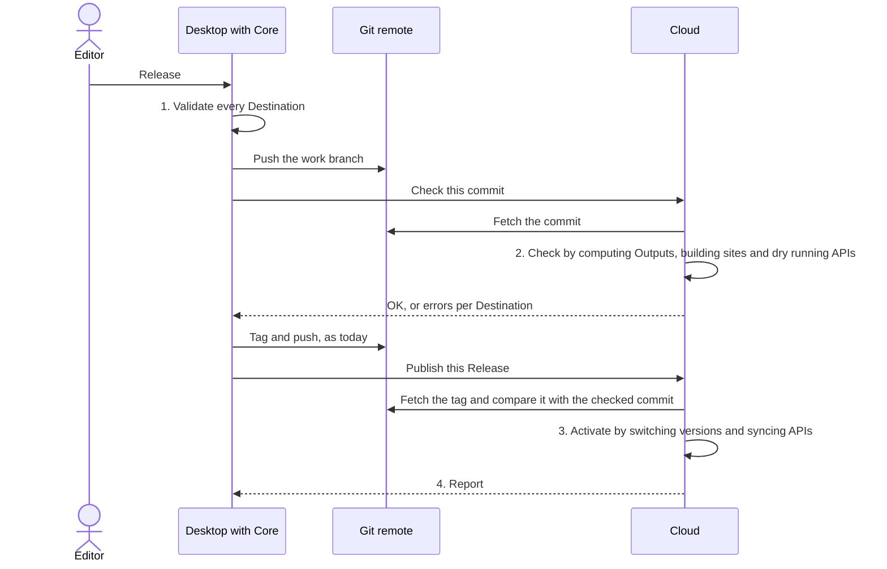

# Destinations

Where a Project's content goes after a Release, and how it gets there. A Destination is a place outside the Project that receives content: Cloud's own Content API, a static website first, and later third-party APIs such as car dealer and real estate portals. This plan defines one mechanism for every kind, so the website can ship first without closing the door on the rest.

It spans Core, Desktop and Cloud. Core holds the model all three share, so the plan lives here. Cloud's half, running builds, hosting sites, syncing APIs and what it needs from an infrastructure provider, is in Cloud's `contributing/destinations.md`.

Nothing here is built. Every name below is a proposal, see [Open questions](#open-questions).

## What we want out of it

- A Release updates every Destination of a Project. The website is rebuilt and deployed, and later the APIs are synced.
- One mechanism carries every kind of Destination. The website is the first kind and APIs the second, and a third kind must not need a redesign.
- The user of Desktop decides which content goes where, through a mapping UI, without a developer.
- Whoever builds a Destination defines what it accepts before any content exists. A website developer does that for their site, and Core does it for each supported API.
- One Entry can feed many Destinations, each in its own shape.
- A Release is blocked while any Destination would reject it, and the editor sees why.
- Content only flows out, and the Project always wins. Importing from another system is a separate, later feature that should reuse the same contract model.

## Terms

| Term | What it is | Who writes it | Where it lives |
| --- | --- | --- | --- |
| Destination | One place content goes: its kind, settings, triggers and mapping | The editor, in Desktop | The Project |
| Contract | The shape a Destination accepts, as Collections and Components | A website developer, by exporting Collections, or Core for an API | The site's repository or Core, copied into the Project |
| Mapping | Which Project content fills which contract field, and how | The editor, in Desktop | The Project, inside the Destination |
| Output | The contract-shaped content one Release produces for one Destination, in the shape of a Project | Core computes it | Never committed. Computed where it is used: in Desktop to validate, in Cloud from the fetched Release, or in a self-hosted build |
| Kind | The code that delivers an Output: serve it through Cloud's Content API, build and host a site, or sync an API | elek.io | Core declares it, Cloud runs it |

## One mechanism, four steps

Every kind goes through the same four steps. Only steps 2 and 3 differ per kind, and that is the extension point a new kind fills in.

| Step | Runs in | Content API | Website | API, later |
| --- | --- | --- | --- | --- |
| 1. Validate | Core, locally, before the Release | Compute the Output and check it against the contract | Same | Same |
| 2. Check | Cloud, before the tag | Compute the Output from the fetched candidate | Also build the site into a new version, without serving it | Also dry run against the API's sandbox or validation endpoint |
| 3. Activate | Cloud, after the tag | Serve the new version | Serve the new version | Create, update and delete the remote items |
| 4. Report | Cloud to Desktop | The version now served | Live URL and build log | Result per item, retries |

Steps 1 and 2 block the Release. Step 3 cannot, because a tagged Release cannot be taken back from an external system. A failure there is retried and shown as "out of sync", never as a failed Release.



**Cloud fetches the Release from the Project's remote**, the way a self-hosted site's CI already provisions one, rather than Desktop uploading it. Every Asset crosses the editor's connection once, Cloud serves what is tagged in git, and the editor can close the laptop after the push. It reverses Cloud's decided "content reaches Cloud by upload", and Cloud's `contributing/destinations.md` weighs that. A Project whose Destinations need no Cloud runs step 1 only, then releases as today.

**Checking a candidate needs provisioning to accept a commit.** It takes a channel or an exact version today, see [`provisioning.md`](../docs/provisioning.md#channels-and-pinned-versions), and the candidate has no tag yet. The tag differs from the checked commit only in `project.json`, because `core.releases.create()` merges `work` and then writes the version.

## What lives in the Project

```text
{projectId}/
|-- destinations/
|   |-- {destinationId}/
|   |   |-- destination.json   kind, name, settings, triggers and the mapping
|   |   |-- contract.json      a copy of the contract the mapping was made against
```

The copy of the contract keeps the Project self-contained. Desktop validates offline against it and a Release stays reproducible. It is replaced only when the editor accepts a new contract version.

Three things never go into the Project:

- **Credentials**, such as API keys, build hook URLs or FTP passwords. Cloud holds them. A Destination that Desktop triggers itself keeps its secret in the OS keychain.
- **Sync state**, meaning which Entry is which remote item. Cloud holds it, because it changes on every sync and would otherwise produce a commit each time.
- **Outputs and built sites.** They are derived from a Release and would turn every Release into a large commit.

```json
{
  "objectType": "destination",
  "id": "8d0b2c1e-5a3f-4f7e-9c1d-2b6a7e4f0a11",
  "coreVersion": "0.24.0",
  "created": "2026-10-09T10:00:00.000Z",
  "updated": null,
  "name": "Website",
  "kind": "website",
  "contract": { "id": "@acme/dealer-site", "version": "1.2.0" },
  "settings": { "hosting": "cloud", "siteId": "4b1f9e0a-0c55-4d39-8a2e-6f3b1d7c9e20" },
  "triggers": { "isOnRelease": true, "isOnPreview": true },
  "languages": { "send": "one", "order": ["de", "en"] },
  "mapping": {}
}
```

## Contract

**A contract is a set of Collections and Components in Core's own schemas, unchanged**, plus a small envelope. There is no second way to define fields. Every field type, constraint, validation rule and migration step that Collections have, a contract has too, and none of it is maintained twice.

```json
{
  "id": "@acme/dealer-site",
  "version": "1.2.0",
  "languages": "any",
  "collections": [],
  "components": []
}
```

- **`collections` and `components`** hold `collection.json` and `component.json` files exactly as `src/schema/collectionSchema.ts` and `src/schema/componentSchema.ts` define them, ids and `coreVersion` included.
- **`label` and `description` are what the mapping UI shows.** Both are `partialTranslatableStringSchema` at the schema level, and the rule that every Project language is filled in is applied by the services, not the schema. So a contract written in English and German validates as it is, and Desktop shows it to a French editor with a fallback.
- **References keep working without translation.** An `entry` field's `ofCollections` and a `dynamic` field's `ofComponents` name ids, and the contract carries the Collections and Components behind those ids. The export checks that every referenced one is included.
- **`languages`** is the one property the schemas have no place for: the languages the site supports, or `any`.
- **Editor-only properties such as `inputWidth` and `icon` stay in.** The mapping ignores them, and "Create Collection from contract" carries them over.

**A developer makes a contract the way an editor makes a model.** They create the Collections the site needs in a Project in Desktop, fill in sample content, and export the Collections as a contract, from Desktop or with the CLI. They develop the site against that Project with the loaders as they work today. Writing the JSON by hand stays possible, and the CLI validates it.

**Keep the Project the contract was made in.** Field ids are the identity a mapping binds to, so recreating a Collection by hand gives every field a new id and breaks every mapping. If that Project is lost, importing the contract into a new one restores it with its ids.

**The author versions it with semver, and Core computes the bump.** The diff Releases already use, `diffCollections` and `diffComponents` in `src/service/ReleaseService.ts`, works on Collection and Component files with no git involved. Extracted from the service, it compares two contract versions with the same classification as in [`releases.md`](../docs/releases.md#how-the-bump-is-decided).

For an API, Core ships one contract per supported API in the same format and versions it with Core.

### A feature a contract needs goes into Collections first

This is the rule that keeps one vocabulary. Three needs are already known:

- **A single item**, such as a site's settings. Collections are always lists today, and singletons are useful to editors as well.
- **What APIs will add**, listed in the next section.
- **Anything a website developer asks for later.**

### What APIs will add to the vocabulary

The website does not need these, so they wait for the first API. Following the rule above, they become features of Collections, and a contract gets them from there.

- **Catalogs.** Large option lists the portal maintains, such as makes, models and equipment, where one list can depend on another.
- **Required under a condition.** Battery capacity only for electric cars, cold rent only for rentals. A plain `requiredWhen`, never a formula language.
- **Units and structured values.** Kilometres, kilowatts, square metres, a price with currency and VAT, an address.

## How a contract reaches a Project

**A website is code without content, and its contract lives in its repository** as `elek.contract.json`, next to the code it describes. Everything else holds a copy. Desktop never needs a list of every site that exists. It needs one copy per Destination, and a way to hear that a newer version exists.

| Channel | For | How the copy arrives | How Desktop hears of a new version | Needs |
| --- | --- | --- | --- | --- |
| Site registry | Sites Cloud builds and hosts, visible to one organization | The developer publishes a site version, code and contract together, with the CLI. Desktop lists the organization's site versions through Cloud's Management API | The registry lists it | Cloud |
| Marketplace | Public themes | The same registry, with versions visible to everyone after a review | The same | Cloud |
| The Project | Self-hosted sites whose developer can push to the content repository | The CLI adds the contract to the Project, commits and pushes. The editor sees it after the next synchronize | The next push | Write access to the Project's remote |
| Import | Everyone else | The editor picks the file the developer sent | It does not. The editor imports again | Nothing |

**The marketplace is not a separate mechanism.** It is the registry with public visibility, so building it later adds a review and a listing, not a new way to get contracts.

**The Project is already the channel between a developer and an editor.** Both work on the same git repository, so a self-hosted site needs no registry at all, and that path stays free of Cloud.

**A new version waits for the editor.** Whichever channel brings it, Desktop offers it next to the version in use. The Destination keeps the old version until the editor has mapped everything the new one requires.

**A self-hosted site names its Destination** in `elek.config.ts`, next to the Project it reads. At build time the loader compares the site's own `elek.contract.json` with the version the Destination uses. When they are incompatible, for example because the site was deployed before the editor mapped a new required field, the build fails and says so.

## Mapping

The editor builds it in Desktop, and it is stored in `destination.json`.

- **Each contract Collection names its source**: which Project Collection feeds it, and an optional filter such as "only where Status is For sale".
- **Each contract field names its source**: which Project field definition feeds it. Both sides are matched by `id` rather than by slug, the same rule as in [`schema-changes.md`](../docs/schema-changes.md#the-golden-rule-field-definitions-are-matched-by-id).
- **The editor only sees plain-language options**: a fixed value, combining fields, matching option values, and the language. Nothing else is shown to the editor.
- **Conversions between field types are automatic**, such as markdown to plain text or an Asset to a URL. They come from a closed list in Core. No user code exists anywhere, so Cloud and every build can run a mapping safely.
- **A single-language Destination asks once** which Project language to send, with a fallback order. A field can override that.
- **The mapping is closed over references.** A mapped reference field requires the contract Collection it points at to be mapped too. The validator checks that.

Keys on the left are contract ids, values on the right are Project ids:

```json
{
  "collections": {
    "<contract cars collection id>": {
      "from": {
        "collectionId": "<project vehicles collection id>",
        "where": [{ "fieldDefinitionId": "<status field id>", "equals": "for-sale" }]
      },
      "fields": {
        "<contract title field id>": { "fieldDefinitionId": "<project name field id>" },
        "<contract description field id>": {
          "fieldDefinitionId": "<project description field id>",
          "language": { "order": ["de", "en"] }
        },
        "<contract dealer field id>": { "fieldDefinitionId": "<project location field id>" }
      }
    }
  }
}
```

## The engine

One pure function in Core takes a Release's content, a contract and a mapping, and returns the Output plus a list of issues. It reads the Project and does nothing else.

| Runs in | For |
| --- | --- |
| Desktop, while editing | Live preview with a real Entry, readiness badges |
| Desktop, at Release | Step 1 |
| Cloud, for every Destination it carries | Step 2, from the fetched candidate, and the Outputs it serves, builds and syncs |
| A Cloud-hosted website build | Nothing. The build reads the Output Cloud computed |
| A self-hosted website build | Core's Astro loader computes the Output from the provisioned Release |

**Cloud runs the Core version the Release was written with.** Provisioning already refuses content written by a newer Core with `VersionSkew`, and pinning the exact version means Cloud computes the same Output Desktop validated in step 1.

### The Output has the shape of a Project

**The Output is the contract's Collections and Components, holding Entries the mapping produced.** Each Entry keeps the id of the Project Entry it came from, its values are keyed by the contract's field slugs, and references point at contract Collection ids. Asset metadata comes along, and Asset references stay ids into the Assets the Release already uploads.

So a site reads an Output exactly as it reads the Project its developer built the contract in. The site's code, its loaders and its generated types are the same in both places, and the developer never writes code for "my sample Project" and "the customer's mapped content" separately.

**One thing has to be built for that.** The loaders read through Core's services, and `ProjectService.read()` asks git for the Project's remote through `toProject()`. An Output written as a folder with the Project layout is therefore not readable as it is. Either the build turns it into a git repository marked as a provisioned copy, or the loaders get a second source that reads files. Decide when the loader is built.

The Output is deterministic, so Cloud can diff two Outputs to plan an API sync.

## Cloud's Content API is one more kind

Everything that leaves a Project goes through a Destination, Cloud's read API included. The editor sees one list of where content goes, and one mapping UI decides what each place receives.

- **The default is all content, as it is.** Its contract is the Project's own model, derived rather than written, and its mapping maps everything to itself. A Project that sets nothing up gets what the Content API serves without Destinations.
- **An Output has the shape of a Project**, so the Content API serves it through the same endpoints as Core's [local API](../docs/local-api.md), and the generated client keeps working.
- **A mapped Content API Destination is opt in.** It keeps internal Collections out of the API, and gives an app a contract that stays put while the Project's model changes.
- **Core's local API has to serve Destinations the same way**, so local development and production read the same paths. How a path names a Destination rather than a Project is open.

## Validation

One set of rules runs at three moments.

1. **While mapping.** Static compatibility between the two field types, and whether the source constraint is at least as strict as the target's. A source `max: 150` into a target `max: 80` warns.
2. **While editing.** Desktop shows the contract's constraints next to the field and a readiness badge per Entry, for example "Not ready for Website: no photo".
3. **At Release.** Step 1 runs the engine over all mapped content, and any issue blocks.

An issue carries the Entry id, field definition id, language, contract field and a message. That matches the issues in [`schema-changes.md`](../docs/schema-changes.md#resolving-non-deterministic-changes), so Desktop can render both the same way.

## What changes in existing Core behavior

- **Schema changes and deletes.** Removing a field or Collection a mapping uses must not be silent. The schema-change issues and the delete protection in `src/service/ReferenceService.ts` extend to Destinations.
- **The Release diff.** Destination changes become part of the `ReleaseDiff` in `src/schema/releaseSchema.ts`. How they classify is open.
- **The Release flow.** `src/service/ReleaseService.ts` gains step 1 and a point before tagging where the Cloud check runs. Core should own that rather than Desktop, for the reason the [reporting plan](./reporting.md) gives: otherwise the CLI reimplements it. `src/service/CloudService.ts` gains a publish namespace next to `core.cloud.reports`.
- **Loaders and export.** `src/astro/loaders.ts` learns to read an Output, see [The Output has the shape of a Project](#the-output-has-the-shape-of-a-project). `elek export` learns to write Outputs.
- **The Release diff as a library.** `diffCollections`, `diffComponents` and the field diffs leave `src/service/ReleaseService.ts` as plain functions, so contract versions are classified by the same rules.
- **Provisioning.** A provisioned copy already includes every committed file, so `destinations/` arrives with it and a self-hosted build can compute its own Output. See [`provisioning.md`](../docs/provisioning.md).
- **Migrations.** `destination.json` carries `coreVersion` like every object file, so the migration chain covers it.

## Website first

The website is one kind with two hosting modes.

| | Cloud-hosted | Self-hosted |
| --- | --- | --- |
| Who fetches the Release | Cloud, in a trusted job | The developer's own CI, as [`provisioning.md`](../docs/provisioning.md) already describes |
| Who builds | Cloud, in a sandbox that sees only the site's Output | The developer's own CI |
| Content into the build | The Output Cloud computed | Computed by Core's loader from the provisioned Release |
| Contract into the Project | From the site registry, see [How a contract reaches a Project](#how-a-contract-reaches-a-project) | Pushed into the Project with the CLI, or imported by the editor |
| Going live | Cloud switches to the new version | A build hook, or the push webhook from [Acting on content changes](../docs/provisioning.md#acting-on-content-changes) |
| Needs Cloud | Yes | No |

Self-hosted keeps Core and Desktop usable without Cloud, which Cloud's own invariants require.

A Cloud-hosted site reaches Cloud by upload. The developer publishes a site version with the CLI: the code plus its contract. That matches how content reaches Cloud, by upload and never by Cloud reading a repository. Marketplace themes later use the same path.

### Work for the first version

Core:

1. The contract envelope, exporting Collections and Components as a contract, validating one, and importing one back into a Project with its ids.
2. The Destination file, its service as `core.destinations`, and its migration step.
3. The mapping schema, the engine and the validator with its issues.
4. Delete protection and schema-change issues for mapped fields.
5. Step 1 in the Release, pushing the candidate, and the calls that ask Cloud to check it and later to publish the tag.
6. A loader that reads an Output, a Destination per Project in `elek.config.ts`, and `elek export` for Outputs.
7. CLI commands to publish a site version to Cloud and to push a contract into a Project.
8. The Release diff extracted into plain functions, to classify contract versions.
9. Provisioning a commit, for the candidate.
10. The derived contract for "all content, as it is", and the local API serving Destinations.

Desktop:

1. A Destinations list per Project, adding a website Destination from the registry or from a file, and offering a newer contract version.
2. The mapping screen: one row per contract field, suggestions filled in, only compatible fields offered, "Add to Collection" for a missing field, the language choice, and a preview with a real Entry.
3. Readiness badges and contract constraints in the Entry editor.
4. The Release dialog with results per Destination and the build log.
5. Exporting Collections as a contract, for developers.

Use elek.io's own website as the first real contract.

## APIs later

What the first API adds, and nothing else:

- The vocabulary from [What APIs will add](#what-apis-will-add-to-the-vocabulary).
- In Cloud, a trusted sync worker, stored credentials, sync state, and two variants: item sync with one call per item, and feeds with the whole Output as one file.
- In Desktop, a dialog to match option values against a catalog, and connecting an account.
- Previews go to the API's sandbox where one exists.

The four steps do not change. That is the test this mechanism has to pass when the first API arrives.

## Rejected

| Alternative | Why not |
| --- | --- |
| A contract format of its own, such as a `defineContract()` API | A second vocabulary to maintain, with its own validation and migrations, and a developer could not build the model in Desktop |
| Discovering themes on npm by keyword | No review, no link to hosting, and a site is not necessarily a package |
| Reading the contract from the deployed site's URL | The site is not deployed before its content is mapped, and the live site would become the source of what it accepts |
| Websites code against the Project's own schema, as today | The developer cannot start before the content model exists, and a schema change breaks the site |
| The contract becomes the Collection, with no mapping | One Entry usually feeds several Destinations in different shapes. Kept as a shortcut: "Create Collection from contract" |
| The developer writes the mapping in code | The editor cannot own it, and Cloud cannot run it safely |
| Release webhooks to Zapier, Make or n8n | The mapping lives outside the Project, with no validation and no versioning. Could become a later kind |
| Desktop uploads the Release to Cloud | Every Asset crosses the editor's connection twice, the laptop has to stay online until the upload ends, and Cloud serves what a client says was released rather than the tag |
| A Cloud-hosted build fetches the Release itself, as self-hosted CI does | Untrusted theme code would hold a read token for the whole repository |
| The editor's machine builds the site | Needs a container runtime on every editor machine, builds differ per machine, and every image is uploaded twice. See Cloud's doc |
| A Forgejo pipeline builds the site | Rejected for publishing in Cloud's `content-delivery.md`, and the same reasons hold for builds |

## Open questions

- **A Project without a remote** cannot be fetched. Adding Cloud's own repository, which every Project gets, fixes that, and Desktop has to say so.
- **How a Content API path names a Destination**, since `/content/v1/projects/{projectId}` names a Project.
- **Names.** "Channel" is taken by provisioning refs, and "contract" is also the name of the `core-report-contract` package.
- **How Destination changes classify** in the Release diff. They do not change the Project's own model, so patch is the likely answer.
- **What a candidate is keyed by.** The version from `prepare()` can move if `work` moves, so a candidate id bound to the version at finalize is likely.
- **Step 2 duration.** A site build can take minutes. Decide what the Release dialog shows, and what happens if the editor closes Desktop meanwhile. Likely the candidate expires and nothing is tagged.
- **Singletons.** Whether Collections get a single-item mode before the first website needs site settings, or the mapping picks one Entry until then.
- **Where a pending contract version sits** in the Project when the CLI pushes one, next to `contract.json` or inside `destination.json`.
- **Languages in generated types.** Types generated from the developer's Project narrow values to that Project's languages, while a contract with `languages: any` serves Projects with other ones.
- **A self-hosted Destination's secret**, such as its build hook URL. The OS keychain through Desktop is the likely home.
